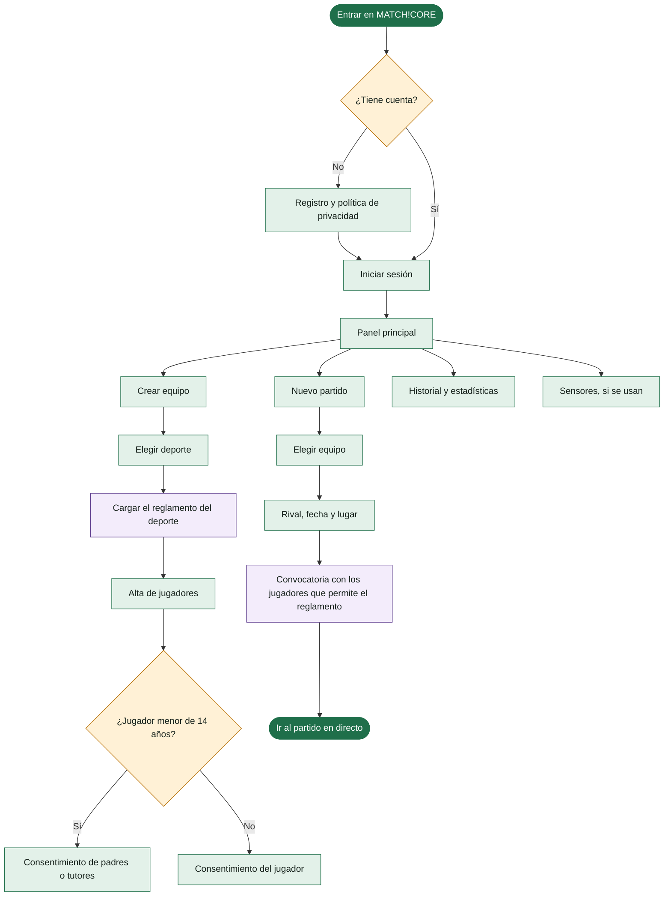
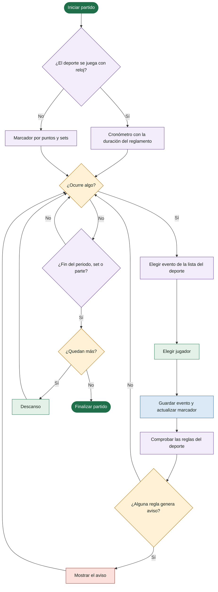
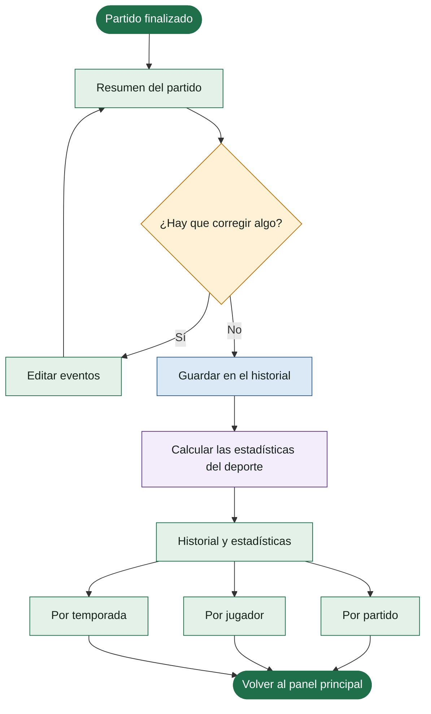

# Diagrama de flujo de MATCH!CORE

El flujo es el mismo para todos los deportes. Lo que cambia de uno a otro (tiempo, eventos, cambios y avisos) lo pone el **reglamento de cada deporte**.

También está como imagen: [SVG](MATCHCORE_diagrama_flujo.svg) · [PNG](MATCHCORE_diagrama_flujo.png).

**Colores:** verde claro = pantalla · amarillo = decisión · azul = acción automática · morado = depende del deporte · rojo = aviso · verde oscuro = inicio o fin.

## 1. Acceso y preparación

## 2. Partido en directo

## 3. Después del partido

## 4. Qué pone el reglamento de cada deporte

| Deporte | Tiempo | Eventos | Cambios | Avisos |
|---|---|---|---|---|
| Fútbol | 2 partes de 45 min, reloj corrido | Gol, falta, tarjeta amarilla y roja, cambio | Limitados según la competición; quien sale no vuelve | Segunda amarilla: expulsión |
| Fútbol sala | 2 partes de 20 min, reloj parado | Gol, falta, tarjeta, cambio, tiempo muerto | Ilimitados y volantes | 5 faltas acumuladas en la parte: desde la sexta, doble penalti |
| Baloncesto | 4 cuartos de 10 min, reloj parado | Canasta de 1, 2 o 3 puntos, rebote, falta personal, técnica | Ilimitados | 5 faltas personales: jugador eliminado. Desde la 5.ª falta de equipo en el cuarto: tiros libres |
| Balonmano | 2 partes de 30 min | Gol, exclusión de 2 min, tarjeta amarilla, roja y azul | Ilimitados | Cuenta atrás de la exclusión. Tercera exclusión: descalificación |
| Voleibol | Sin reloj: sets a 25 puntos (el quinto a 15), gana quien llega a 3 sets | Punto, saque, bloqueo, cambio, tiempo muerto | Limitados por set, con rotación | Fin de set y de partido |

Añadir otro deporte más adelante consiste en escribir su reglamento, sin tocar el flujo.
