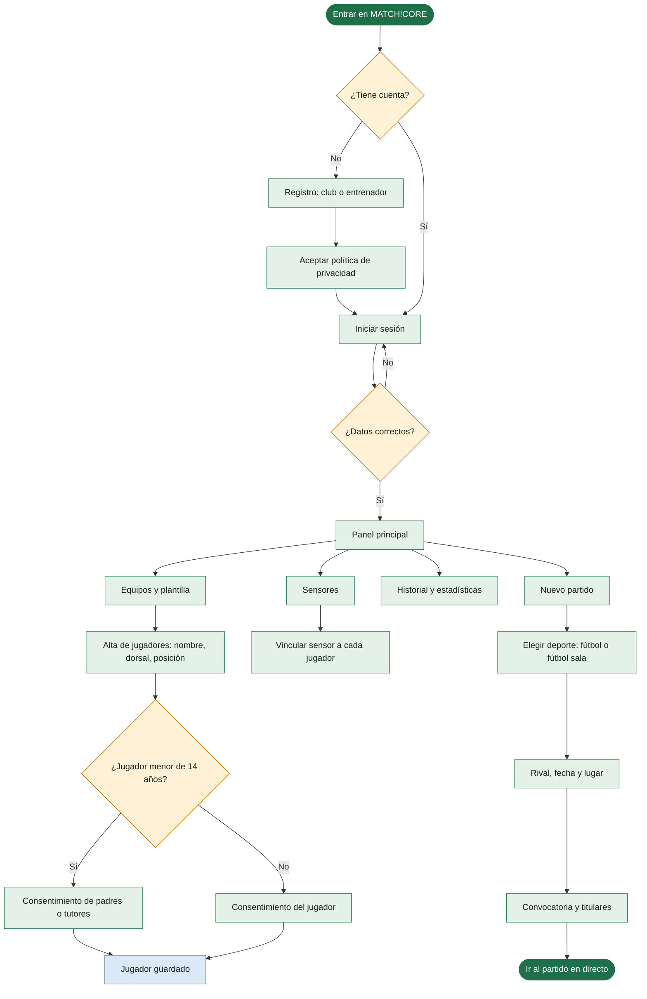
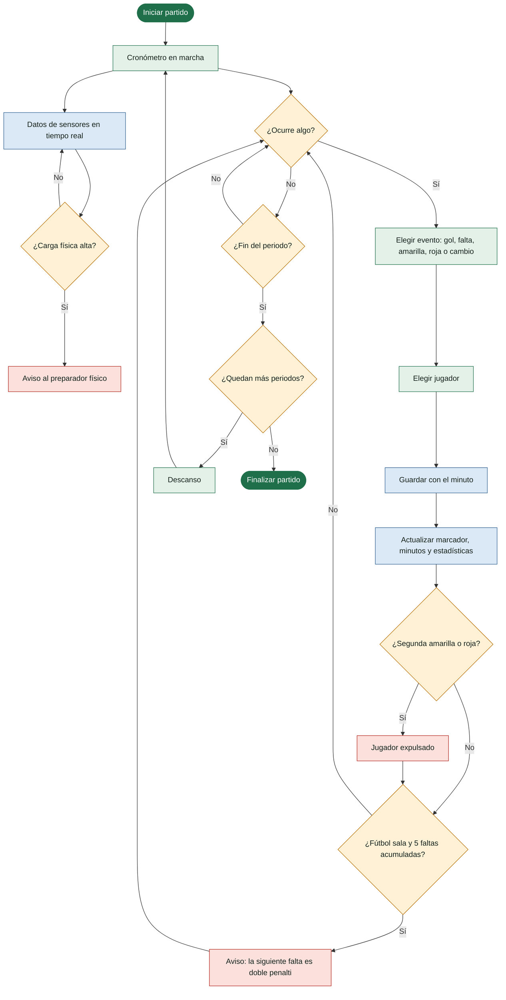
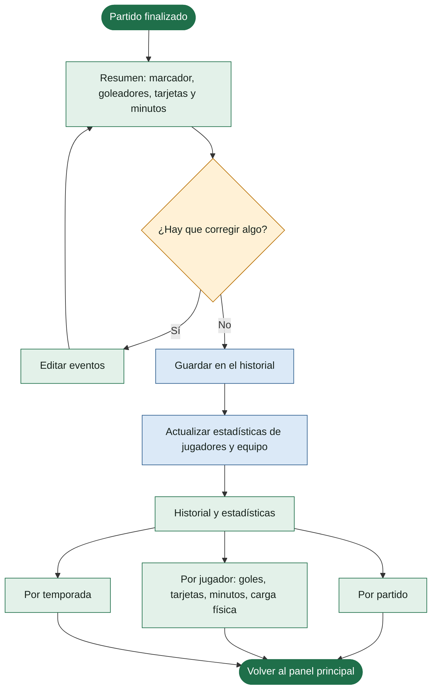

# Diagrama de flujo de MATCH!CORE

Recorrido del entrenador por la aplicación: antes, durante y después del partido.

También está como imagen: [SVG](MATCHCORE_diagrama_flujo.svg) · [PNG](MATCHCORE_diagrama_flujo.png).

**Colores:** verde claro = pantalla · amarillo = decisión · azul = acción automática · rojo = aviso · verde oscuro = inicio o fin.

## 1. Acceso y preparación

## 2. Partido en directo

## 3. Después del partido

